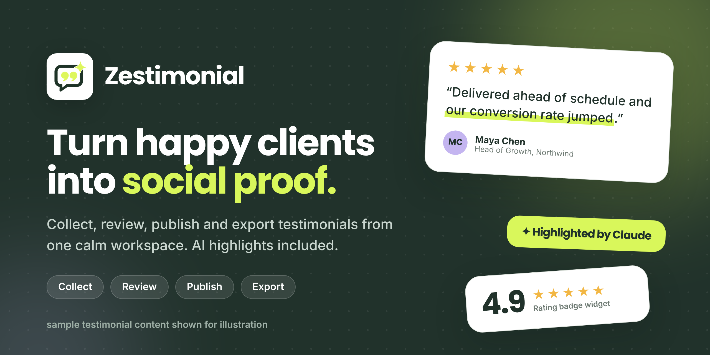
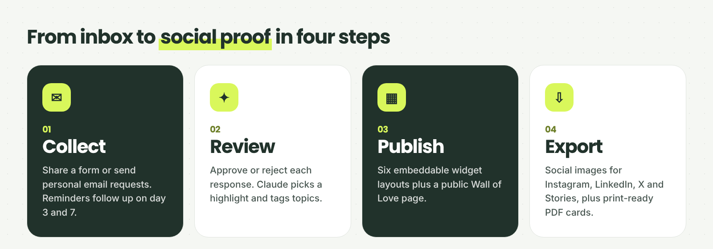
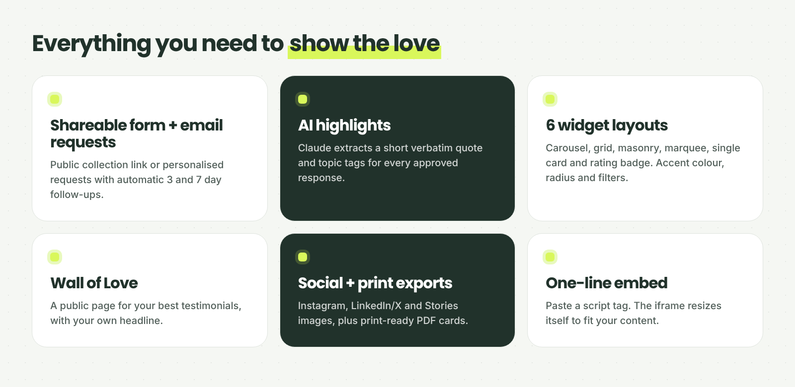
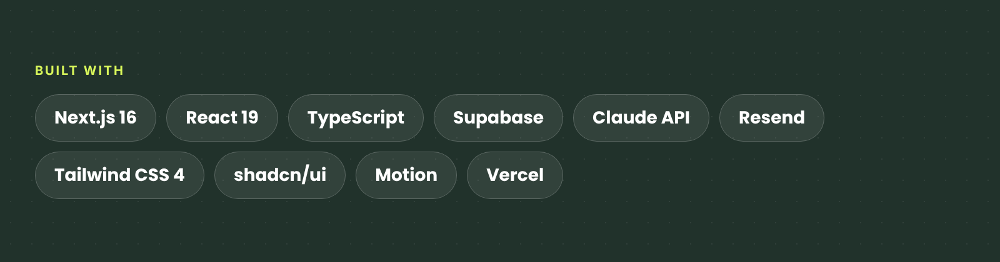

<div align="center">



<br />

# Zestimonial

**Collect, review, publish and export client testimonials from one calm workspace.**<br />
AI picks the best line. Your clients stay quoted word for word.

<br />

[](https://zestimonial.vercel.app)
[](https://github.com/micheal-khan/Zestimonial/releases)
[](https://github.com/micheal-khan/Zestimonial/stargazers)
[](https://github.com/micheal-khan/Zestimonial/network/members)
[](https://github.com/micheal-khan/Zestimonial/issues)

[](https://github.com/micheal-khan/Zestimonial/commits/main)
[](https://github.com/micheal-khan/Zestimonial)
[](https://github.com/micheal-khan/Zestimonial)
[](https://github.com/micheal-khan/Zestimonial/pulls)
[](https://nodejs.org)


[**Try it live**](https://zestimonial.vercel.app) · [Features](#features) · [How it works](#how-it-works) · [Getting started](#getting-started) · [Embedding a widget](#embedding-a-widget) · [Deploying](#deploying) · [Project layout](#project-layout)

</div>

---

## Why Zestimonial

Client praise usually ends up buried in inboxes, DMs and screenshots. Zestimonial gives freelancers and small studios one place to ask for it, approve it, and put it to work on a website, in a proposal, or in a social post.

## How it works



- **Collect**: a shareable form, plus personal email requests with automatic follow-ups after 3 and 7 days.
- **Review**: approve or reject responses. Claude picks a short verbatim highlight and topic tags for each one.
- **Publish**: embeddable widgets (carousel, grid, masonry, marquee, single card, rating badge) and a public Wall of Love page.
- **Export**: social images sized for Instagram, LinkedIn/X and Stories, plus print-ready PDF cards.

## Features



| | |
| --- | --- |
| **Collection form** | A public page per workspace, with star rating, role and consent. |
| **Email requests** | Personal invitations through Resend, linked to the client's own request. |
| **Auto reminders** | A daily cron sends up to two follow-ups, after 3 and 7 days, and stops once the client responds. |
| **AI highlights** | Claude returns one persuasive line, copied exactly, plus up to three topic tags. The highlight is discarded if it is not literally present in the quote, so clients are never paraphrased. |
| **Topic tags** | `results`, `communication`, `speed`, `quality`, `expertise`, `value`, `creativity`, `reliability`, `support`, `process`. Filter a widget by tag. |
| **Widgets** | Six layouts with accent colour, corner radius, item limit, role and rating toggles, and light or dark theme. |
| **Wall of Love** | A public page for your best testimonials with your own headline. |
| **Export studio** | 1080 × 1080 Instagram, 1200 × 630 LinkedIn/X and 1080 × 1920 Story images in dark, light or brand themes, plus print-ready cards you can save as PDF. |
| **Dashboard** | Sidebar app shell, command palette, notifications and dark mode. |
| **Secure by default** | Postgres row level security on every table. The service role key stays on the server. |

## Tech stack



Next.js 16 (App Router), Supabase (auth + Postgres), Resend (email), Claude (AI highlights), Tailwind CSS 4, shadcn/ui on Base UI, and Motion.

## Getting started

1. Clone and install dependencies (Node 22.13 or newer):

   ```bash
   git clone https://github.com/micheal-khan/Zestimonial.git
   cd Zestimonial
   npm install
   ```

2. Copy `.env.example` to `.env.local` and fill it in:

   | Variable | Required | Purpose |
   | --- | --- | --- |
   | `NEXT_PUBLIC_SUPABASE_URL`, `NEXT_PUBLIC_SUPABASE_ANON_KEY` | Yes | Supabase project, used for sign-in |
   | `SUPABASE_SERVICE_ROLE_KEY` | Yes | Server-side database access. Never expose it to the browser |
   | `RESEND_API_KEY`, `RESEND_FROM_EMAIL` | For email | Request, reminder and new-testimonial emails. Without them, requests are saved and you share the link yourself |
   | `ANTHROPIC_API_KEY` | For AI | Highlights and topic tags. Without it, everything else works |
   | `APP_URL` | In production | Public URL used in email links and social previews, e.g. `https://zestimonial.app` |
   | `CRON_SECRET` | In production | Random string that protects `/api/cron/reminders` |

3. Apply the database migrations in `supabase/migrations/`, in order, using the Supabase SQL editor or `supabase db push`.

4. In Supabase → Authentication → URL configuration, add `<your URL>/auth/callback` and `<your URL>/auth/update-password` as redirect URLs.

5. Run the app:

   ```bash
   npm run dev
   ```

   Open [http://localhost:3000](http://localhost:3000) and sign up.

## Scripts

| Command | What it does |
| --- | --- |
| `npm run dev` | Start the development server |
| `npm run build` | Production build |
| `npm run start` | Serve the production build |
| `npm run lint` | Lint and type-check with oxlint |
| `npm run format` | Format with oxfmt |

## Embedding a widget

Create a widget on the Widgets page and copy its embed code:

```html
<script src="https://your-app.example/embed.js" data-zestimonial-widget="WIDGET_ID" async></script>
```

The script inserts an iframe that resizes itself to fit its testimonials. A plain `<iframe>` version is also available on the same page.

## Deploying

The app is set up for Vercel. `vercel.json` schedules the follow-up reminder job daily at 14:00 UTC. Vercel sends `CRON_SECRET` with each run automatically, so set it in the project's environment variables.

## Project layout

```
app/
  (dashboard)/        Signed-in pages that share the sidebar layout (overview, testimonials, requests, widgets, exports, profile)
  api/                Route handlers. `public/` routes need no sign-in; `cron/` is for scheduled jobs
  collect/[slug]/     Public testimonial form
  love/[slug]/        Public Wall of Love page
  embed/[id]/         Widget page shown inside the embed iframe
  embed.js/           Script that embeds a widget and resizes it to fit
components/           App components; `components/ui/` holds shadcn/ui primitives
lib/                  Server and shared logic (Supabase clients, email, AI, reminders, widgets)
supabase/migrations/  Database schema
proxy.ts              Refreshes the session and redirects signed-out visitors to /login
docs/                 README images and LinkedIn launch graphics
```

## Contributing

Issues and pull requests are welcome. If you build something with Zestimonial, open an issue and share it.

If it saves you time, a ⭐ on the repo helps other freelancers find it.

<div align="center">

Made by [@micheal-khan](https://github.com/micheal-khan)

</div>
